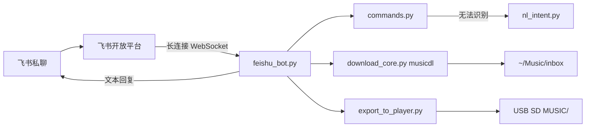

# raspberry-pi-feishu-music

> 项目状态：当前功能版本已完成并归档，进入稳定维护阶段。后续有明确需求时再继续升级；运行和真机验证边界见 [docs/STATUS.md](docs/STATUS.md)。

通过**飞书私聊**遥控树莓派：搜索并下载音乐到本机目录，再导入 USB 读卡器中的 SD 卡，最后把卡插入艾利和播放器使用。

下载能力基于 [musicdl](https://github.com/CharlesPikachu/musicdl)。桌面 GUI `musicdownload.py` 来自上游 [MrsEWE44/musicDownload](https://github.com/MrsEWE44/musicDownload)，树莓派 Lite **不需要**该 GUI。

GitHub 仓库：<https://github.com/Blissamys/raspberry-pi-feishu-music>（记录时为公开仓；是否改为私有以 GitHub 设置为准）。

进度与交接状态以 [docs/STATUS.md](docs/STATUS.md) 为准。后续升级前仍需先核对工作区、树莓派运行文件和文档。

## 已实现（以代码为准）

- 飞书 **WebSocket 长连接**收消息（`im.message.receive_v1`），不使用公网 HTTPS 回调 URL
- 仅处理 `FEISHU_ALLOW_OPEN_IDS` 中的用户
- 固定指令：`歌曲…`、`盘`、`导入`、`进度`、`删除本地 …`、`删除本地全部`、`帮助`
- `歌曲歌名`：立即搜索并下载**第一条**结果
- 自然语言（关键词；可选本地小模型）：如下载类会先搜 1～3 首候选，等「确认」/ `1`/`2`/`3` 再下载
- 下载完成后主动回复文件名、大小、码率、格式（能读到则含时长）
- 下载先写入临时目录再整理到 `~/Music/inbox`
- `盘`：列出 inbox 与 USB SD 上的音频
- `导入`：rsync 音频和 `.lrc` 到 SD 的 `MUSIC/`，排除 `.pkl` 等缓存，可卸载
- systemd 单元模板：`music-feishu.service`

**已验证 / 未验证**见 [docs/STATUS.md](docs/STATUS.md)，不要把计划中的能力当成线上已有功能。

## 飞书到树莓派的流程



1. 用户在飞书发文字（可用飞书语音转文字）。
2. `feishu_bot.on_message` 校验 `open_id`，解析指令。
3. 下载/搜索/导入在后台线程执行，避免卡住长连接。
4. 完成后用飞书「回复消息」接口把结果发回同一条会话。
5. 用户发 `导入` 后，将 inbox 同步到已识别的 USB FAT/exFAT 分区；显示导入完成后再拔卡插入艾利和。

## 技术栈与运行环境

| 项 | 实际使用 |
|----|----------|
| 语言 | Python 3（树莓派现场为系统 Python 3.13 量级，待与 `python3 --version` 再核） |
| 飞书 SDK | `lark-oapi`（`lark.ws.Client`） |
| 下载 | `musicdl` |
| 音频标签 | `tinytag` |
| 导入 | 系统 `rsync`、`lsblk`、`mount`/`umount` |
| 可选 LLM | Ollama 兼容 OpenAI `/v1/chat/completions`（默认未启用） |
| 进程 | systemd `music-feishu.service` 或前台 `python3 feishu_bot.py` |

依赖声明：`requirements.txt`（机器人）、`requirements-dev.txt`（pytest）、`requirements-gui.txt`（Mac GUI）。无 lock 文件。

**已验证硬件（现场）：** 树莓派 4B 4G、Raspberry Pi OS 64-bit Lite、主机名 `musicpi`、用户 `shawpi`。物理内存无法升级到 6G。

## 目录结构

```
.
├── feishu_bot.py          # 飞书长连接入口
├── commands.py            # 固定指令解析、open_id 白名单
├── nl_intent.py           # 自然语言关键词 + 可选 LLM
├── download_core.py       # 搜索、下载、平铺、读标签
├── export_to_player.py    # 列目录、删本地、挂载、rsync
├── musicdownload.py       # 上游 PySide6 GUI（可选，Pi Lite 不用）
├── feishu.env.example     # 环境变量占位符；复制为 feishu.env，勿提交
├── music-feishu.service   # systemd 模板，将 YOUR_USER 换成实际用户
├── sudoers-iriver-mount   # 免密 mount/umount 模板
├── 99-iriver-msc.rules    # 可选：卷标 IRIVER 自动挂载
├── requirements.txt
├── requirements-dev.txt
├── requirements-gui.txt
├── tests/
├── docs/
└── AGENTS.md
```

不纳入版本库：`feishu.env`、`.venv/`、`~/Music/inbox`、`.musicdl_temp/`、音频与日志。见 `.gitignore`。

## 最小可运行步骤

在**将要跑机器人的机器**上（通常是树莓派）：

```bash
git clone git@github.com:Blissamys/raspberry-pi-feishu-music.git
cd raspberry-pi-feishu-music
python3 -m venv .venv
source .venv/bin/activate
pip install -r requirements.txt
cp feishu.env.example feishu.env
# 编辑 feishu.env：填入飞书凭证，勿提交
set -a && source feishu.env && set +a
python3 feishu_bot.py
```

飞书侧必须：机器人能力、单聊收发权限、事件长连接、`im.message.receive_v1`、**应用已发布**。详见 [docs/DEPLOYMENT.md](docs/DEPLOYMENT.md)。

生产环境还需要：USB 读卡器、曲库 SD（建议卷标 `IRIVER`）、免密 `mount`（`sudoers-iriver-mount`）、以及把 `music-feishu.service` 装到 `/etc/systemd/system/`。

## 飞书指令

固定指令（`commands.parse_command`，优先于自然语言）：

| 用户发送 | 行为 |
|----------|------|
| `歌曲晴天` 或 `歌曲 晴天 周杰伦` | 立即搜索并下载第一条 |
| `盘` | 列出 inbox 与 SD 音频 |
| `导入` | rsync 到 SD 后可卸载 |
| `进度` | 当前任务状态 |
| `系统状态` / `树莓派状态` / `运行状态` / `硬件状态` | CPU 使用率/负载/温度、内存与 Swap、文件系统空间、开机时长、供电/降频 |
| `删除本地 晴天` | 删除 inbox 中路径含该词的音频及对应 `.lrc` |
| `删除本地全部` 或 `清空本地` | 清空 inbox 音频 |
| `确认` / `是` / `1`/`2`/`3` | 确认自然语言搜索的候选 |
| `取消` | 放弃待确认下载 |
| `帮助` | 帮助文本 |

自然语言（仅当固定指令无法识别时，`nl_intent.route_natural_language`）：

- 关键词示例：`帮我下载晴天`、`删掉本地情歌`、`把歌拷到SD`（**代码已实现，飞书真机未验证**）
- `LLM_ENABLED=1` 且本机 OpenAI 兼容接口可用时，再尝试小模型 JSON 意图（**Ollama 安装未完成，未验证**）

删除本地支持“删掉本地那首轻熟女”，也支持粘贴“盘”列表里的单条路径及大小。原始文件名优先匹配；复制的列表行按完整相对路径匹配。部署状态见 [STATUS.md](docs/STATUS.md)。

`歌曲…` **不会**走候选确认，会直接下载。搜索/下载/导入进行中会拒绝新的同类任务；忙碌时确认保留候选，搜索中取消后不会恢复候选。关闭 LLM 时，关键词写操作要求明确指令句，“不要删除本地全部”“怎么导入”不会直接执行。

## 其他文档

- [AGENTS.md](AGENTS.md) — 给后续开发者/AI 的约束与入口
- [docs/HANDOFF.md](docs/HANDOFF.md) — 最短交接说明与接手提示词
- [docs/STATUS.md](docs/STATUS.md) — 进度、差异、下一步（状态以这份为准）
- [docs/ARCHITECTURE.md](docs/ARCHITECTURE.md) — 调用链与设计决策
- [docs/DEPLOYMENT.md](docs/DEPLOYMENT.md) — 树莓派部署与维护
- [docs/DEVELOPMENT.md](docs/DEVELOPMENT.md) — 本地开发与测试
- [docs/LOCAL_LLM.md](docs/LOCAL_LLM.md) — 可选 0.5B 模型（安装**未验证**）


## 双 USB 曲库模式

需先配置并部署 `storage.json`，状态见 [STATUS.md](docs/STATUS.md)。文件记录下载 U 盘与播放器 SD 的不同 UUID 及固定挂载位置；模板为 `storage.example.json`，真实配置不进 Git。

新下载保存在下载 U 盘 `inbox/`；U 盘未插入、挂载异常时明确报错，不回退写入树莓派系统卡。原有树莓派 `~/Music/inbox` 不自动迁移、清空或纳入双盘导入。双盘模式的“删除本地”只作用于下载 U 盘的 inbox。

日常插入 SD 后：

| 指令 | 作用 |
|------|------|
| `存储` | 只读查看两盘角色、UUID、连接及挂载状态 |
| `导入预览`（或 `导入`） | 挂载已绑定设备，扫描下载 U 盘全部音频和 SD 全部已有音频，列出新增、重复、冲突和空间需求；不复制音乐 |
| `确认导入` | 仅确认自己的最新预览，复制新增歌曲到 SD 的 MUSIC/ 下，保留源相对目录；校验完成后同步并卸载 SD |
| `进度` | 查看扫描/复制任务进度 |
| `取消` | 清除待确认的候选及导入计划，不中止已开始的复制 |
| `弹出SD` | 无任务进行时同步并卸载绑定的 SD；不卸载下载 U 盘 |

按音频标签的“歌名＋歌手”去重，忽略大小写、宽窄字符、空格差异及合唱歌手的逗号/顿号/分号顺序。不同语言别名、不同写法不做猜测匹配，Live/Remix 等版本词保留。文件内容完全相同也视为重复。SD 上已有版本优先；源盘内部重复只复制一份。缺标签或同路径不同歌曲列为冲突，不自动复制或覆盖；SD 存在缺标签歌曲时，无法排除跨格式重复的新增项也会暂缓；SD 既有重复仅报告、不删除。因此不会自动清理所有历史重复或标签不一致的同曲。

预览有效期 10 分钟；配置、设备或音频/歌词变化需重新预览。仅导入音频与关联歌词，不复制 pkl/缓存。中途失败可能已有部分完整歌曲复制成功；重新预览会跳过这些歌曲，并为内容完全相同的音频补齐缺失歌词。必须等明确“已安全卸载，可以拔卡”的回复后拔 SD；失败提示不能视为安全弹出。


## 搜索与导入交互（部署状态见 STATUS）

自然语言搜索最多缓存 20 条多源候选，每页 3 条，各来源轮流展示；相同歌曲的不同来源保留供选择。候选包含来源、标题提示的现场/伴奏/混音/翻唱线索及源站标注的格式/大小，均不等于实际音质保证。`歌曲…` 仍保持第一条立即下载。

| 指令 | 行为 |
|------|------|
| `换一批` / `上一批` | 翻阅缓存候选，不重新访问源站；1/2/3 只对应当前页 |
| `只搜QQ 晴天` | 指定来源和关键词；也支持网易云、酷我、酷狗 |
| `只搜QQ` / `重新搜索` | 复用自己的上次关键词，重新访问来源；重新搜索保留上次来源选择 |
| `重新搜索 歌名 歌手` | 更换关键词重搜；新的“帮我下载…”使用全部默认来源 |
| `待处理` / `待处理 2` | 按页查看未处理的导入冲突，编号在本次计划内固定 |
| `冲突详情 1` | 查看该项文件、标签、冲突原因与目标路径 |
| `标记同曲 1` / `跳过冲突 1` | 只在本次计划跳过该项，不改标签、不删除文件 |
| `确认新增 1` | 人工确认该项不是重复歌曲后加入计划；仍需确认导入才复制，不能强行覆盖同名文件 |

搜索候选和导入预览均为十分钟有效；翻页或处理冲突不续期。取消清除候选和计划；重新预览会重新编号，旧计划的决定不自动继承。

导入进度分为扫描、等待确认、复制、校验、安全卸载；`进度` 可查看当前文件、字节或已完成数量及耗时。复制中断会报告已完成的音频数，重新预览后跳过已完成项。若仅卸载失败，按提示发“弹出SD”重试，不重复复制；只有明确安全卸载成功后才拔卡。未处理冲突不会复制，但其它已确定的新增项仍可导入。

源站空结果可能是无匹配或该源未正常返回，机器人不据此断言歌曲未收录。下载未生成本次可确认的新音频文件时报告失败，不拿已有文件冒充本次下载成功。
