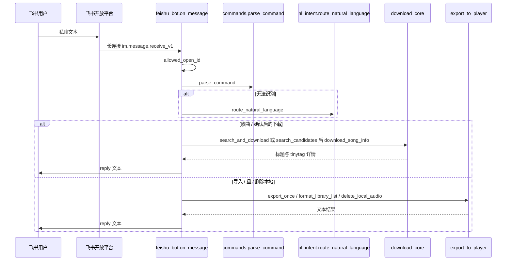

# 架构与设计决策

依据当前仓库代码。进度见 [STATUS.md](STATUS.md)。

## 调用链

入口：`feishu_bot.main()` 创建 `lark.EventDispatcherHandler`，注册 `register_p2_im_message_receive_v1(on_message)`，`lark.ws.Client(...).start()`。

`on_message` 只处理 `message_type == "text"`。内容为 JSON 字符串，取出 `text`。群聊与私聊共用解析；自然语言路由不依赖 `p2p` 参数（`parse_command` 仍接收该参数但未区分行为）。

## 模块

| 模块 | 关键符号 | 作用 |
|------|----------|------|
| `feishu_bot.py` | `handle_command`、`_start_keyword_download`、`_start_download_info`、`reply_text` | 任务线程、待确认 `_pending`、飞书回复 |
| `commands.py` | `parse_command`、`allowed_open_id` | 固定口令；环境变量白名单 |
| `nl_intent.py` | `heuristic_intent`、`_chat_complete`、`route_natural_language` | 先关键词，再可选 LLM JSON |
| `download_core.py` | `search_candidates`、`download_song_info`、`flatten_downloaded`、`inspect_audio` | musicdl；临时目录；tinytag |
| `export_to_player.py` | `pick_player_partition`、`export_once`、`rsync_inbox` | USB 分区、列表、删除、rsync |

`musicdownload.py` 不参与飞书路径。

## 配置

进程从**环境变量**读取（systemd 通过 `EnvironmentFile=.../feishu.env`）：

| 变量 | 必填 | 用途 |
|------|------|------|
| `FEISHU_APP_ID` | 是 | 应用 ID |
| `FEISHU_APP_SECRET` | 是 | 应用密钥 |
| `FEISHU_ALLOW_OPEN_IDS` | 是（空则拒绝所有人） | 逗号分隔 `ou_` |
| `LLM_ENABLED` | 否，默认关 | `1`/`true`/`yes` 才请求本地模型 |
| `LLM_BASE_URL` | 否 | 默认 `http://127.0.0.1:11434/v1` |
| `LLM_MODEL` | 否 | 默认 `qwen2.5:0.5b` |

飞书回复：每次 `reply_text` 用 app_id/secret 新建 `lark.Client` 调 `im.v1.message.reply`。无应用级配置文件 besides env。

## 存储

| 位置 | 内容 |
|------|------|
| `Path.home()/Music/inbox` | 整理后的音频（常量 `INBOX_DEFAULT`） |
| `inbox/.musicdl_temp` | musicdl 工作目录 |
| `/media/iriver` | 期望挂载点；`DEST_SUBDIR_DEFAULT=MUSIC` |
| 内存 `_job` | `idle`/`running` + 详情字符串 |
| 内存 `_pending[open_id]` | 自然语言搜索的候选列表 |

搜索开始即占用任务状态，并以 pending 对象标识该次请求；取消会移除它，迟到的结果不会恢复候选。新搜索失败会清除候选。重启进程会丢失 `_job` 与 `_pending`。无数据库、无磁盘任务队列。

## 安全与可靠性（代码里实际有的）

| 能力 | 现状 |
|------|------|
| 身份 | `allowed_open_id`；未授权会回复其 `open_id` 便于配置（仍不要把 Secret 发进聊天） |
| 重复事件 | **未做**去重（无 message_id 缓存） |
| 并发 | 下载/导入/搜索用 `threading.Thread`；搜索/下载/导入在同一锁内检查并占用 running；忙碌时确认保留候选；盘/删除本地尚未纳入该任务锁 |
| 超时 | LLM HTTP `timeout=20`；musicdl/飞书 SDK 无额外封装超时 |
| 失败 | 线程内 catch 后 `reply_text` 错误信息；systemd `Restart=on-failure` |
| 系统盘保护 | 筛选及挂载入口显式拒绝名称/路径为 `mmcblk0` 及其分区的设备 |
| 导入过滤 | rsync `--include` 音频/lrc，`--exclude` `*.pkl` 等 |

## 设计决策与限制

1. **长连接而非公网 URL：** 树莓派无稳定公网时更简单。限制：同一应用同时只能有一套有效长连接；Mac 与派不要一起跑 bot。
2. **`歌曲` 立即下载 vs 自然语言先确认：** 保留已验证的快捷路径，避免把所有下载都改成两步。限制：说错歌名若用了 `歌曲错字` 仍可能下错。
3. **只下搜索第一条（固定指令）：** 实现简单。限制：多源时取遍历到的第一条，不一定是「最佳音质」。
4. **4G 内存只用 0.5B 级模型（计划/可选）：** 物理内存不能加到 6G。LLM 默认关闭，避免未安装 Ollama 时阻塞。
5. **USB 只认可移动 FAT/exFAT：** 避免写系统 mmc。限制：多读卡器空槽 0B、设备名 `sdX` 会变。
6. **白名单空则全拒绝：** 防止机器人被他人使用。

## 系统状态指令

`commands.parse_command` 将“系统状态／树莓派状态／运行状态／硬件状态”路由到 `system_status.format_system_status`；原“状态／进度”仍返回任务进度。沿用 on_message 白名单，运行中的下载不会阻止只读状态查询。

采集器只用标准库：读取 /proc 与温度 sysfs，CPU 总使用率采样 0.2 秒（不重复计入 guest），内存按 total − available 估算，shutil.disk_usage 查询现有文件系统空间。vcgencmd get_throttled 使用固定参数和 2 秒超时，分别报告当前及开机以来的历史标志；不用 sudo，不扫描或操作块设备，不读取 env、日志或密钥。每项读取失败单独显示“不可用”。根文件系统与 inbox 若在同一文件系统，容量会重复显示，不能当作两份可用空间。

## 双盘角色与去重导入

`storage_roles.py` 每次读取本机 storage.json；未配置时保留本机模式。配置存在但无效时不回退。UUID 从 lsblk 的 USB 文件系统元数据中唯一匹配（排除 MMC major 179，并再次拒绝 mmcblk0），不用 sda/sdb 顺序。源/目标 UUID、物理设备及挂载目录必须不同；挂载目录不能是符号链接或互相嵌套。source_directory 为机器人下载/删除/列表提供统一源目录，系统状态只检查现有挂载，不主动挂载。prepare_import 扫描整个源 U 盘，包含既有音频和新下载的 inbox。

`library_sync.py` 使用 TinyTag 元数据键与 SHA-256 辅助去重。Plan 为冻结的内存数据，包含两盘音频/歌词的路径、大小、mtime_ns 和哈希快照，以及新增/重复/冲突项；不写缓存到播放器。确认时验证 10 分钟有效期、完整快照、当前配置、UUID、挂载路径及剩余空间，逐首复制前后检查设备。预览与确认的哈希会读完整音频，大曲库需要等待。

每个目标文件先在同目录生成唯一 .part，fsync 和 SHA-256 校验后使用 Linux renameat2(RENAME_NOREPLACE) 发布，存在目标时失败而非覆盖；非 Linux 测试环境使用排他 hardlink 发布。不支持 no-replace 的文件系统会报错，不降级到覆盖。歌词单独复制。失败仅清理由本次生成的未发布临时文件，保留已有音乐。

bot 的 _import_pending 按 open_id 隔离；取消清除令牌，迟到预览不恢复。预览/导入/弹出/列表/删除与下载共用任务锁；固定系统状态与存储信息仍可只读查询。双盘模式旧导入转预览；成功导入后只有 sync -f 和 umount 成功且确认未挂载才提示可拔卡。不要把本地测试通过等同于 FAT 真机验证。

独立审查后的补强：source_session/import_session 保持目录 fd，并在网络操作/写入边界重新核对 UUID、配置及 st_dev/inode；正常卸载会被活跃目录引用阻止，复制结束先关闭 fd 再卸载。新建源挂载点在未挂载时设为 0555，避免 mount 丢失后 mkdir 回落。SD 缺少标签的音频列入 unknown_target；无法排除跨格式重复的新增音频暂停为冲突。与 SD 音频 SHA-256 完全相同的源歌词可单独补齐，以便失败重试恢复。

## 搜索分页与冲突决定

search_ui.py 负责纯文本呈现、来源别名及十分钟有效期。download_core.search_candidates 的 diverse=True 保留来源差异并轮询来源顺序；bot 搜索收集至多20项，_pending 保存 results/offset/choices，确认始终取当前页 choices。_last_search 按 open_id 保存查询与来源，取消候选后明确“重新搜索”仍可复用查询；不保存到磁盘。版本只按标题中的独立英文词或中文词提示，不判断原唱或音质。

Plan 新增稳定编号 issues、decisions 和 skipped。Conflict 包含 Copy、原因、标签展示及 can_add；同路径冲突禁止 add，元数据不确定的项需人工明确 add。resolve_conflict 返回新的不可变计划，保留原 created 时间，并再次检查目标与计划内路径/歌曲重复以及容量；不执行复制。真正 execute 仍完整检查设备、预览快照和失效时间。未处理 issues 不参与复制。same/skip 均为本次决定，未创建永久别名映射。

复制与哈希校验回调只更新内存进度，不向飞书逐块刷消息；最终结果才主动回复。ImportInterrupted 保留已完成音频/歌词数量，卸载失败则保留完整复制数量并提示单独重试弹出。旧单盘导入同样不再吞掉 umount 错误。

下载成功判定补强：musicdl 返回路径与回退发现均检查本次前后文件签名、规范化路径、非空音频扩展名和工作目录范围；未产生本次可确认的新音频不回复成功。导入路径冲突不仅检查文件名，也检查每一级父目录是否被既有/计划文件占用（不区分大小写），人工处理也不能绕过。
